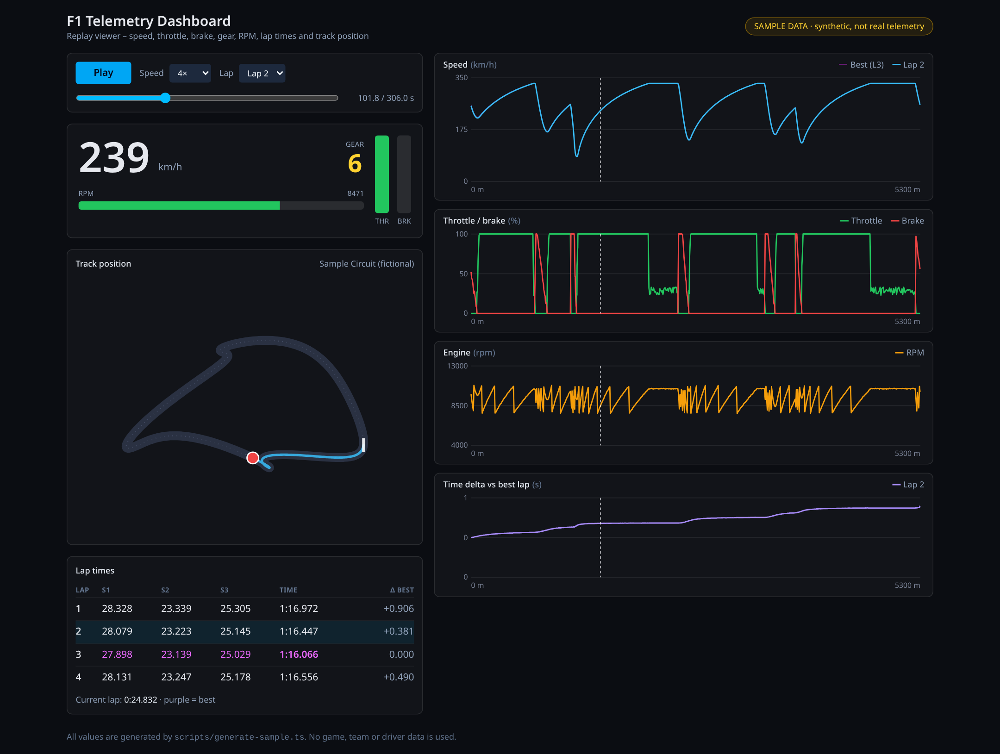
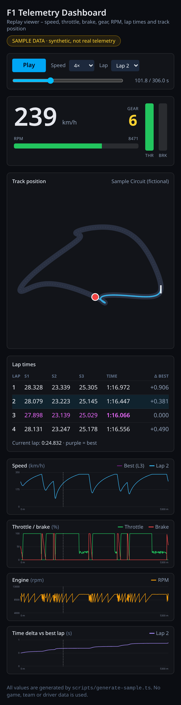
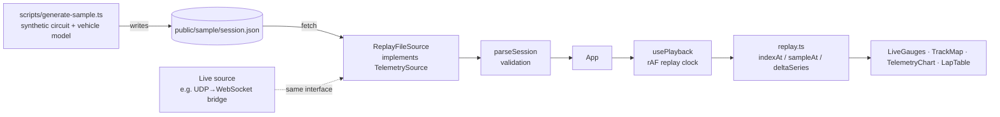

# F1 Telemetry Dashboard

[](https://github.com/OWNER/f1-telemetry-dashboard/actions/workflows/ci.yml)
[](LICENSE)

A demo-able racing telemetry dashboard: **speed, throttle, brake, gear, RPM, lap and sector times, a live track map and a time-delta chart**, all driven by a replay file. React 19 + TypeScript + Vite + Tailwind CSS 4, no chart library (hand-written SVG charts).

> **All data is synthetic.** The replay in `public/sample/session.json` is generated by `scripts/generate-sample.ts` from a made-up circuit and a simple vehicle model. It is not real telemetry and contains no game, team or driver data. This project is not affiliated with, or endorsed by, Formula One companies or any game publisher; "F1" is used descriptively.



<details><summary>Mobile layout</summary>



</details>

**Live demo:** published by the GitHub Pages workflow (`.github/workflows/deploy-pages.yml`) once Pages is enabled for the repository.

## Features

- Replay clock with play/pause, 0.5×–4× speed, scrubber and jump-to-lap
- Live panel: speed, gear, RPM bar with redline colours, throttle and brake bars
- Track map with the car marker and the trail of the current lap
- Lap table with sector times, best-lap/best-sector highlighting and delta to best
- Charts over lap distance: speed (current lap vs. best-lap ghost), throttle/brake, RPM and the running **time delta vs. the best lap**
- Input validation of the replay file (clear error if it is malformed)
- A `TelemetrySource` interface so a live source can replace the replay file

## Quick start

```bash
npm install
npm run dev          # http://localhost:5173
npm test             # Vitest
npm run lint         # ESLint (typescript-eslint, react-hooks)
npm run typecheck    # tsc --noEmit
npm run build        # type-check + production build into dist/
npm run generate:sample   # regenerate public/sample/session.json (deterministic, seed 20260504)
```

Requires Node.js 22+.

## Architecture



| Path | Responsibility |
|---|---|
| `scripts/generate-sample.ts` | Deterministic synthetic session generator (corner-speed limits from curvature, forward/backward acceleration and braking passes, 10 Hz resampling) |
| `src/lib/session.ts` | Validates the compact JSON format and converts it into typed samples |
| `src/lib/replay.ts` | Binary-search lookup, interpolation, lap helpers, time-at-distance and delta series |
| `src/hooks/usePlayback.ts` | `requestAnimationFrame` replay clock with rate and looping |
| `src/components/*` | Presentational components; charts are plain SVG |

## Feeding it with real data (optional, not included)

The dashboard only needs a `TelemetrySource`. The author's open-source UDP parser libraries for racing games ([`f1-22-udp`](https://www.npmjs.com/package/f1-22-udp), [`f1-2021-udp`](https://www.npmjs.com/package/f1-2021-udp), [`f1-23-udp`](https://www.npmjs.com/package/f1-23-udp)) emit typed events that could be forwarded to the browser through a small WebSocket bridge. Illustrative sketch (event and field names should be checked against the library README):

```ts
// bridge.ts – runs in Node next to the game, NOT part of this repository's build
import { F122UDP } from 'f1-22-udp'
import { WebSocketServer } from 'ws'

const wss = new WebSocketServer({ port: 8080 })
const udp = new F122UDP()
udp.start() // listens on the game's UDP port (default 20777)

udp.on('carTelemetry', (packet) => {
  const me = packet.m_carTelemetryData[packet.m_header.m_playerCarIndex]
  const msg = JSON.stringify({ speed: me.m_speed, throttle: me.m_throttle, brake: me.m_brake, gear: me.m_gear, rpm: me.m_engineRPM })
  wss.clients.forEach((c) => c.send(msg))
})
```

A `WebSocketSource` would then accumulate these messages into `Sample`s. That adapter is intentionally left out so the demo stays self-contained and runs without any game.

## What this demonstrates

- **React + TypeScript (strict)** with hooks, memoised derived data and a clean split between pure logic (`src/lib`) and presentation
- **Data visualisation without a framework**: scales, ticks, cursors, ghost laps and delta charts written as small SVG components
- **Domain modelling**: samples, laps, sectors, interpolation across lap boundaries, running time delta
- **Input validation** at the boundary (`parseSession`) with descriptive errors, and an interface (`TelemetrySource`) that keeps the UI independent of where data comes from
- **Testing**: unit tests for parsing, interpolation, formatting and the generator (determinism, plausibility, "committed sample is up to date"), component tests with Testing Library
- **Tooling and delivery**: ESLint with typescript-eslint, GitHub Actions CI (lint, type-check, test, build) and a GitHub Pages deployment workflow

## Possible next steps

- `WebSocketSource` + the bridge above, with a ring buffer for live mode
- Lap comparison between any two laps, sector-level deltas
- Playwright smoke test against the production build

## License

[MIT](LICENSE). Synthetic data generated by this repository's script.
